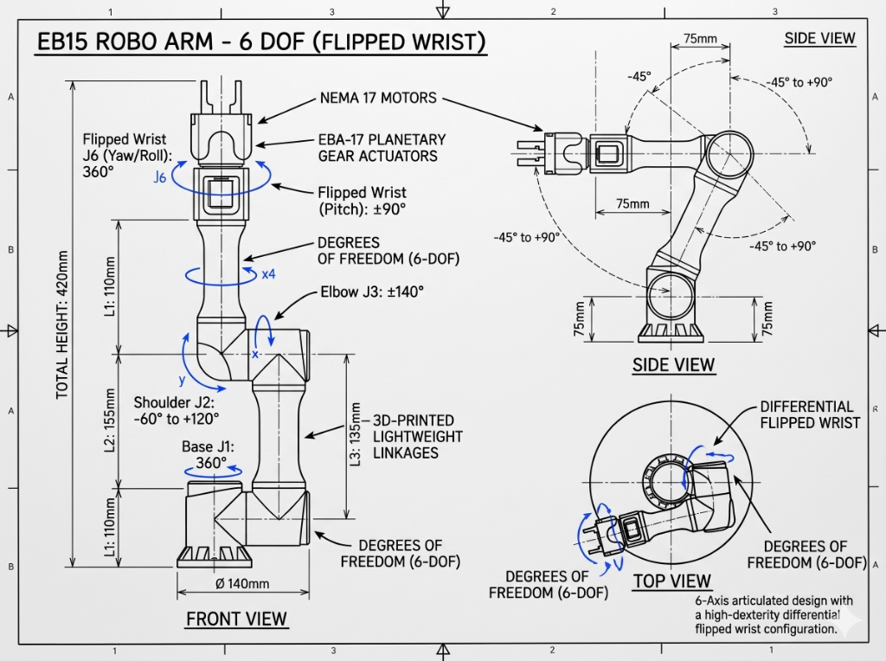

# EB-15 Collaborative Robot Arm: Comprehensive Kinematics, Dynamics, and URDF Manual

> **Course & Reference Manual:** A rigorous, pedagogical guide covering Forward Kinematics (DH parameters), Analytical Inverse Kinematics, Differential Kinematics (Jacobian & Singularities), Euler-Lagrange Dynamics, and complete URDF physical modeling for the **EB-15 5-DOF Robot Arm**.

---

## Table of Contents
1. [Robot Architectural Overview & Coordinate Frames](#1-robot-architectural-overview--coordinate-frames)
   - [Official Engineering Blueprint: EB-15 6-DOF (Flipped Wrist)](#official-engineering-blueprint-eb-15-6-dof-flipped-wrist)
   - [Physical Hardware & Open-Source Mechanical Architecture](#physical-hardware--open-source-mechanical-architecture)
   - [Kinematic Skeleton & Joint Coordinate Wireframe](#kinematic-skeleton--joint-coordinate-wireframe)
   - [Deep-Dive Degrees of Freedom (DOF) Analysis](#deep-dive-degrees-of-freedom-dof-analysis)
   - [Physical Link Lengths & Dimensional Reference](#physical-link-lengths--dimensional-reference)
   - [Joint Rotation Axes & Right-Hand Rule Conventions](#joint-rotation-axes--right-hand-rule-conventions)
   - [Workspace Reach Envelope & Annular Volume](#workspace-reach-envelope--annular-volume)
2. [Denavit-Hartenberg (DH) Parameter Formulation](#2-denavit-hartenberg-dh-parameter-formulation)
3. [Forward Kinematics (FK) Algebraic Derivation](#3-forward-kinematics-fk-algebraic-derivation)
4. [Analytical Inverse Kinematics (IK) Step-by-Step Derivation](#4-analytical-inverse-kinematics-ik-step-by-step-derivation)
5. [Differential Kinematics & Geometric Jacobian](#5-differential-kinematics--geometric-jacobian)
6. [Robot Dynamics: Euler-Lagrange Formulation](#6-robot-dynamics-euler-lagrange-formulation)
7. [URDF Architecture & Link-by-Link Deep Dive](#7-urdf-architecture--link-by-link-deep-dive)
8. [Worked Numerical Example & Verification](#8-worked-numerical-example--verification)
---

## 1. Robot Architectural Overview & Coordinate Frames

The **EB-15** is an articulated collaborative robot arm composed of a **spatial serial kinematic chain** actuated by stepper motors and planetary gearboxes, designed for desktop robotics research, education, and light automation.

---

### Official Engineering Blueprint: EB-15 6-DOF (Flipped Wrist)

The technical blueprint below illustrates the official orthographic engineering drawings (Front View, Side View, and Top View) for the **EB-15 Robo Arm — 6 DOF with Differential Flipped Wrist**:



#### Dimensional Specifications from the Official Blueprint:
* **Base Diameter:** $\varnothing 140\,\text{mm}$ circular mounting base footprint.
* **Base Column Elevation ($L_1$):** $110\,\text{mm}$ (Mounting flange to Shoulder pitch axis $J_2$).
* **Upper Arm Length ($L_2$):** $155\,\text{mm}$ (Shoulder pitch axis $J_2$ to Elbow pitch axis $J_3$).
* **Forearm Link Length ($L_3$):** $135\,\text{mm}$ (Elbow pitch axis $J_3$ to Flipped Wrist pitch pivot).
* **Wrist & Tool Module Length ($L_1$):** $110\,\text{mm}$ (Wrist pivot to gripper tip interface).
* **Total Arm Candle Height:** $420\,\text{mm}$ (Fully extended vertical reference configuration).
* **Joint Offsets & Standoffs (Side Elevation View):**
  - Base vertical riser: $75\,\text{mm}$.
  - Upper arm lateral standoff: $75\,\text{mm}$.
  - Forearm to wrist standoff: $75\,\text{mm}$.

#### Joint Rotation Limits (6-Axis Articulated Design):
* **Base Joint $J_1$ (Pan / Yaw):** $360^\circ$ continuous rotation around the vertical base axis.
* **Shoulder Joint $J_2$ (Pitch):** $-60^\circ \text{ to } +120^\circ$ ($180^\circ$ total elevation stroke).
* **Elbow Joint $J_3$ (Pitch):** $\pm 140^\circ$ ($280^\circ$ total bending range).
* **Forearm Roll $J_4$:** Continuous axial twist along the forearm tube.
* **Flipped Wrist Pitch $J_5$:** $\pm 90^\circ$ ($180^\circ$ tilt range).
* **Flipped Wrist Yaw / Roll $J_6$:** $360^\circ$ continuous tool spin.
* **End-Effector:** Integrated parallel gripper with adaptive jaws.

#### High-Dexterity Differential Flipped Wrist Architecture:
As highlighted in the blueprint's **Top View**, the arm utilizes a **Differential Flipped Wrist** configuration:
1. **Kinematic Decoupling:** Separates tool roll/pitch from arm positioning, eliminating wrist singularities encountered in standard spherical wrists when pointing straight down.
2. **Mass Centering (Inertia Reduction):** The motors driving the wrist joints are mounted further back along the forearm rather than at the distal tip. This minimizes the moment of inertia about Shoulder $J_2$ and Elbow $J_3$, enabling faster dynamic response and dramatically reducing gravity torque loading on the EBA-17 gearboxes.
3. **Planar Symmetry:** The $75\,\text{mm}$ side standoffs mirror each other, maintaining an invariant central sagittal plane for pick-and-place tasks.

---

### Physical Hardware & Open-Source Mechanical Architecture

The **EB-15** is an open-source 3D-printable collaborative desktop robot arm designed by **ToolBoxRobotics**. Unlike cast-metal industrial robot arms (e.g. KUKA or Fanuc), the EB-15 features a distinctive modular 3D-printed architecture:
* **Actuators & Gearboxes:** Driven by standard 42mm NEMA 17 stepper motors coupled to custom **3D-printed annular planetary gearboxes (`EBA-17` and `EBA-17-S`)** providing a **38.4:1 gear reduction ratio** directly at the shoulder and elbow joints.
* **Structural Tubes:** Lightweight cylindrical structural tubes (`009.stl` upper arm and `015.stl` forearm) clamped between high-strength dark gray PETG/PLA joint housings (`006.stl`, `011.stl`, `014.stl`).
* **Planar Lateral Standoff:** An intentional offset on the shoulder motor mount along $+Y$ to accommodate the gearbox thickness, paired with an equal and opposite elbow bracket return offset along $-Y$ to bring the forearm back onto the arm's central sagittal plane.
* **End-Effector:** A modular **EBG-20 adaptive parallel gripper** with dual rack-and-pinion 3D-printed fingers driven by an MG995 RC servo.
* **Sensors:** Non-contact AS5600 12-bit magnetic angle encoders on the joint axes connected via a TCA9548A I2C multiplexer, backed by physical snap-action limit microswitches for zero-homing.

> [!NOTE]
> **Configuration Scaling (Current 5-DOF Build vs. 6-DOF Flipped Wrist Blueprint):**  
> * The **physical desktop arm in this repository** is built with extended aluminum/carbon tubes ($a_2 = 228\,\text{mm}$ upper arm, $a_3 = 265.7\,\text{mm}$ forearm, $73.8\,\text{mm}$ base elevation) with a 1-DOF servo wrist roll and 1-DOF parallel gripper (5 active DOFs).
> * The **official 6-DOF Flipped Wrist blueprint** above provides the mechanical drawing for the compact, high-dexterity 6-axis variant ($L_1 = 110\,\text{mm}, L_2 = 155\,\text{mm}, L_3 = 135\,\text{mm}, \text{Total Height} = 420\,\text{mm}$ with differential 2-DOF flipped wrist). Both configurations share identical EBA-17 planetary gearbox drivetrains, NEMA 17 motors, and kinematic principles.

```mermaid
graph TD
    World["world (Fixed Inertial Frame)"] --> Base["base_link (Z=0, Mounting Flange)"]
    Base -->|Joint 1: Revolute Yaw (Z-axis, continuous)| Link1["link1 (Turntable & Shoulder Column)"]
    Link1 -->|Joint 2: Revolute Pitch (Y-axis, -90° to +90°)| Link2["link2 (Upper Arm, L2=228mm)"]
    Link2 -->|Joint 3: Revolute Pitch (Y-axis, ±154.7°)| Link3["link3 (Forearm Tube, L3=178mm)"]
    Link3 -->|Fixed Adapter (L4=87.7mm)| WristBase["wrist_base_link (Forearm termination)"]
    WristBase -->|Wrist Joint: Revolute Roll (Z-axis, ±90°)| WristLink["wrist_link (Servo Horn)"]
    WristLink -->|Fixed Tool Joint| Tool0["tool0 (Mechanical Interface Flange)"]
    Tool0 -->|Fixed Mount| GripBase["gripper_base_link (EBG-20 Housing)"]
    GripBase -->|Gripper Left Joint: Active Prismatic (0 to 28mm stroke)| LeftFinger["gripper_left_finger_link"]
    GripBase -->|Gripper Right Joint: Passive Mimic (Multiplier = 1.0)| RightFinger["gripper_right_finger_link"]
    GripBase -->|Fixed TCP Offset (88.5mm)| TCP["gripper_tcp (Grasp Center Point)"]
```

---

### Kinematic Skeleton & Joint Coordinate Wireframe

The ASCII wireframe below maps the precise kinematic skeleton, showing the location of each joint center, the direction of its primary rotation/translation axis, and its relative displacement vector:

```text
                                  [gripper_tcp]
                                        ▲
                                        │  L_tcp = 88.5 mm (Offset to Grasp Center)
                                        ▼
                             ◄──────[EBG-20 GRIPPER]──────►
                             (Left Finger: +X, Right Finger: -X)
                                        │
                         ═══════════[tool0]═══════════  (Interface Flange)
                                        │
                               ┌────────┴────────┐
                               │ WRIST ROLL (J4) │  Axis: Z_3 (Roll along forearm)
                               │  Range: ±90.0°  │  Velocity: ω_4
                               └────────┬────────┘
                                        │  L_4 = 87.7 mm (Wrist Adapter & Horn)
                              [wrist_base_adapter]
                                        │
                                        │  Forearm Tube (L_3 = 178.0 mm)
                                        │  Total a_3 = L_3 + L_4 = 265.7 mm
                                        │
                               ┌────────┴────────┐
                        ⊙ ─────│ ELBOW PITCH(J3) │───── ⊙  Axis: Y_2 (Horizontal Pitch)
                       (Y_2)   │ Range: ±154.7°  │  Velocity: ω_3
                               └────────┬────────┘
                                        │
                                        │  Upper Arm Tube & Brackets
                                        │  Length a_2 = L_2 = 228.0 mm
                                        │
                               ┌────────┴────────┐
                        ⊙ ─────│SHOULDER PITCH(J2)───── ⊙  Axis: Y_1 (Horizontal Pitch)
                       (Y_1)   │ Range: ±90.0°   │  Velocity: ω_2
                               └────────┬────────┘
                                        │  h_1 = 43.0 mm (Link 1 Turntable Riser)
                                [link1 Turntable]
                                        │  d_1 = 30.8 mm (Base Flange & Thrust Bearing)
                               ┌────────┴────────┐  Total Elevation d_base = 73.8 mm
                               │  BASE YAW (J1)  │
                               │  Axis: Z_0 (▲)  │  Range: ±180.0° (Continuous Pan)
                               │  Velocity: ω_1  │
                               └────────┬────────┘
                                        │
                         ═══════════════╧═══════════════  [world / base_link]
                         Origin: (0, 0, 0), Ground Level
                         Axes: X_0 = Forward, Y_0 = Left, Z_0 = Up
```

---

### Deep-Dive Degrees of Freedom (DOF) Analysis

A robot's **Degrees of Freedom (DOF)** quantify the minimum number of independent joint variables needed to completely specify the configuration and posture of every link in the mechanism.

#### Mobility Derivation (Chebyshev-Grübler-Kutzbach Formula)
For a spatial mechanism moving in 3D operational space ($\lambda = 6$):
$$
M = 6(N - 1) - \sum_{i=1}^j (6 - f_i)
$$
where:
* $N = 6$ rigid bodies in the primary kinematic path:
  1. `base_link` (Fixed inertial ground)
  2. `link1` (Turntable base & column)
  3. `link2` (Upper arm)
  4. `link3` (Forearm assembly & wrist base)
  5. `wrist_link` (End-effector flange)
  6. `gripper_left_finger_link` (Active finger rack)
* $j = 5$ single-degree-of-freedom kinematic pairs ($f_i = 1$):
  - 4 revolute 1-DOF joints ($J_1, J_2, J_3, J_{\text{wrist}}$)
  - 1 prismatic 1-DOF joint ($J_{\text{grip, left}}$)

Substituting into the mobility criterion:
$$
M = 6(6 - 1) - \sum_{i=1}^5 (6 - 1) = 6(5) - 5(5) = 30 - 25 = \mathbf{5\text{ Active Degrees of Freedom}}
$$

> [!NOTE]
> The second gripper finger (`gripper_right_finger_link`) is driven by the same pinion gear via an equal and opposite gear rack. In mechanical design and in the URDF, this is modeled as a **passive mimic joint** with constraint multiplier $m = 1.0$. Because its motion is 100% holonomically constrained by the left finger ($q_{\text{right}} = q_{\text{left}}$), it adds **0 additional independent degrees of freedom**.

#### Comprehensive 5-DOF Joint Specification Matrix

| DOF Index | Joint Name | Kinematic Type | Joint Axis $\mathbf{\hat{u}}$ | Kinematic Purpose | Actuator & Drivetrain | Feedback Sensor | Motion Range | Step Resolution |
|---|---|---|---|---|---|---|---|---|
| **DOF 1** | `joint1` | Revolute | $\mathbf{\hat{z}} = [0, 0, 1]^T$ | **Base Yaw (Azimuth):** Rotates the sagittal arm plane $360^\circ$ around the base. | NEMA 17 Stepper + EBA-17 Planetary (38.4:1 ratio) | AS5600 12-bit Magnetic Encoder (I2C 0x70/0x36) | $[-3.1416, +3.1416]\,\text{rad}$<br>($\pm 180.0^\circ$) | $2444.6\,\text{steps/rad}$<br>($0.023^\circ$/step) |
| **DOF 2** | `joint2` | Revolute | $\mathbf{\hat{y}} = [0, 1, 0]^T$ | **Shoulder Pitch (Elevation):** Lifts and depresses the upper arm against gravitational torque. | NEMA 17 Stepper + EBA-17-S High-Torque (38.4:1 ratio) | AS5600 12-bit Encoder + Dual Snap-Action Switches | $[-1.5708, +1.5708]\,\text{rad}$<br>($\pm 90.0^\circ$) | $2173.7\,\text{steps/rad}$<br>($0.026^\circ$/step) |
| **DOF 3** | `joint3` | Revolute | $\mathbf{\hat{y}} = [0, 1, 0]^T$ | **Elbow Pitch (Extension):** Controls radial distance from shoulder axis to wrist. | NEMA 17 Stepper + EBA-17 Planetary (38.4:1 ratio) | AS5600 12-bit Encoder + Dual Snap-Action Switches | $[-2.7000, +2.7000]\,\text{rad}$<br>($\pm 154.7^\circ$) | $2173.7\,\text{steps/rad}$<br>($0.026^\circ$/step) |
| **DOF 4** | `wrist_joint` | Revolute | $\mathbf{\hat{z}} = [0, 0, 1]^T$ | **Wrist Roll (Tool Orientation):** Aligns gripper fingers with grasp target geometry. | MG995 High-Torque Servo (Internal Metal Gearbox) | Internal Potentiometer (Servo PWM, 50 Hz) | $[-1.5708, +1.5708]\,\text{rad}$<br>($\pm 90.0^\circ$) | Microsecond PWM Pulse Width ($500-2500\,\mu\text{s}$) |
| **DOF 5** | `gripper_left_joint` | Prismatic | $\mathbf{\hat{x}} = [1, 0, 0]^T$ | **Grasp Stroke:** Translates fingers linearly to clamp or release objects. | MG995 Servo + Dual Pinion/Rack Mechanism | Internal Potentiometer (Servo PWM, 50 Hz) | $[-0.018, +0.015]\,\text{m}$<br>($0 \text{ to } 28\,\text{mm}$ stroke) | Sub-millimeter linear rack positioning |

---

### Physical Link Lengths & Dimensional Reference

All dimensional constants are derived directly from the EB-15 CAD geometry and verified against the URDF kinematic parameters:

| Dimension Symbol | Metric Value (mm) | Metric Value (m) | Kinematic Description | Physical Significance |
|---|---|---|---|---|
| $d_1$ | $30.8\,\text{mm}$ | $0.0308\,\text{m}$ | Base mounting surface to Joint 1 pan plane | Housing for thrust ball bearing and lower turntable flange. |
| $h_1$ | $43.0\,\text{mm}$ | $0.0430\,\text{m}$ | Joint 1 plane to Joint 2 shoulder pitch axis | Height of Link 1 dual vertical riser stanchions. |
| $d_{\text{base}}$ | $\mathbf{73.8\,\text{mm}}$ | $\mathbf{0.0738\,\text{m}}$ | Total ground-to-shoulder vertical elevation | Total offset $d_{\text{base}} = d_1 + h_1$. Base frame elevation. |
| $y_{\text{shoulder}}$ | $+83.8\,\text{mm}$ | $+0.0838\,\text{m}$ | Lateral offset from turntable centerline | Motor mounting distance along $+Y$ to accommodate gearbox. |
| $y_{\text{elbow}}$ | $-83.8\,\text{mm}$ | $-0.0838\,\text{m}$ | Lateral return offset at elbow bracket | Mirror offset along $-Y$; **cancels shoulder offset identically**. |
| $a_2$ ($L_2$) | $\mathbf{228.0\,\text{mm}}$ | $\mathbf{0.2280\,\text{m}}$ | Upper arm link length (Shoulder axis $\to$ Elbow axis) | Primary lifting lever arm experiencing maximum gravitational torque. |
| $L_3$ | $178.0\,\text{mm}$ | $0.1780\,\text{m}$ | Forearm carbon/aluminum tube segment | Length from elbow pivot to the wrist base adapter plate. |
| $L_4$ | $87.7\,\text{mm}$ | $0.0877\,\text{m}$ | Wrist module & servo horn adapter length | Distance from wrist adapter plate to mechanical flange (`tool0`). |
| $a_3$ ($L_{\text{forearm}}$) | $\mathbf{265.7\,\text{mm}}$ | $\mathbf{0.2657\,\text{m}}$ | Total Forearm length (Elbow axis $\to$ `tool0` flange) | Cumulative forearm length: $a_3 = L_3 + L_4$. |
| $L_{\text{tcp}}$ | $\mathbf{88.5\,\text{mm}}$ | $\mathbf{0.0885\,\text{m}}$ | Tool0 flange $\to$ Gripper Grasp Center Point (TCP) | Distance through the EBG-20 parallel gripper housing to fingertip grasp center. |
| $R_{\text{max, tool0}}$ | $\mathbf{493.7\,\text{mm}}$ | $\mathbf{0.4937\,\text{m}}$ | Maximum reach from shoulder axis to `tool0` flange | Full planar extension: $R_{\text{max}} = a_2 + a_3 = 228.0 + 265.7\,\text{mm}$. |
| $R_{\text{max, TCP}}$ | $\mathbf{582.2\,\text{mm}}$ | $\mathbf{0.5822\,\text{m}}$ | Maximum operational reach to fingertip grasp point | Outstretched reach: $R_{\text{TCP}} = a_2 + a_3 + L_{\text{tcp}} = 493.7 + 88.5\,\text{mm}$. |

---

### Joint Rotation Axes & Right-Hand Rule Conventions

Each joint follows the **standard Right-Hand Rule (RHR)**: align the thumb of your right hand along the positive axis vector $\mathbf{\hat{u}}$, and your fingers will curl in the direction of **positive joint rotation ($+q_i$)**.

```text
       RIGHT-HAND RULE DIRECTION CONVENTION:

          Joint 1 (Yaw):                  Joints 2 & 3 (Pitch):               Joint 4 (Wrist Roll):
          
              +Z (Thumb Up)                      +Y (Thumb Out of Page)               +Z (Thumb along Forearm)
                 ▲                                       ▲                                    ▲
                 │                                       │                                    │
           ┌─────┴─────┐                           ┌─────┴─────┐                        ┌─────┴─────┐
       ◄───┤  Counter- ├───►                   ◄───┤ Downward  ├───►                    ◄───┤ Clockwise ├───►
           │ Clockwise │                           │ Forward   │                        │ Roll      │
           └───────────┘                           └───────────┘                        └───────────┘
```

1. **Joint 1 (`joint1`):** Rotation axis $\mathbf{\hat{u}}_1 = [0, 0, 1]^T$.
   - **Positive ($+q_1$):** Counter-clockwise rotation when viewed from above looking down along $-Z$.
   - **Zero Position ($q_1 = 0$):** Arm sagittal plane points straight along $+X$ (robot front).
2. **Joint 2 (`joint2`):** Rotation axis $\mathbf{\hat{u}}_2 = [0, 1, 0]^T$.
   - **Positive ($+q_2$):** Foreward / downward pitch.
   - **Zero Position ($q_2 = 0$):** Upper arm link is pointed strictly **vertically upward** (candle posture along $+Z$).
3. **Joint 3 (`joint3`):** Rotation axis $\mathbf{\hat{u}}_3 = [0, 1, 0]^T$.
   - **Positive ($+q_3$):** Foreward pitch folding towards the base.
   - **Zero Position ($q_3 = 0$):** Forearm is collinear with the upper arm (straight arm).
4. **Joint 4 (`wrist_joint`):** Rotation axis $\mathbf{\hat{u}}_4 = [0, 0, 1]^T$ in the wrist frame (collinear with forearm tube).
   - **Positive ($+q_4$):** Clockwise rotation looking from the forearm towards the gripper fingertips.
   - **Zero Position ($q_4 = 0$):** Gripper fingers open horizontally in the pitch plane.
5. **Joint 5 (`gripper_left_joint`):** Prismatic axis $\mathbf{\hat{u}}_5 = [1, 0, 0]^T$ in the gripper base frame.
   - **Positive ($+q_5$):** Translates finger towards closed position ($+0.012\,\text{m}$).
   - **Negative ($-q_5$):** Retracts finger towards open position ($-0.016\,\text{m}$).

---

### Workspace Reach Envelope & Annular Volume

Because Joints 2 and 3 operate in a planar 2R configuration mounted atop a $360^\circ$ yaw base, the workspace forms an **axisymmetric spherical shell / torus with a hollow inner core**:

```text
                  VERTICAL WORKSPACE CROSS-SECTION (Sagittal Plane)
                  
                   Z (Elevation)
                   ▲
      Zenith Height│          ╭────────────────────────╮
     +656.0 mm ────┼─────────│            ●            │───────── (Fully Extended Upward)
                   │        │       Upper Workspace     │
                   │       │                             │
                   │      │       ╭───────────────╮       │
     Shoulder Axis │     │       │     INNER       │       │
      +73.8 mm ────┼────●───────│   DEAD ZONE    │───────●────
                   │     │       │   (Unreachable) │       │
                   │      │       ╰───────────────╯       │
                   │       │                             │
        Mounting ──┼────────│                             │
      Surface 0.0  │         ╰───────────────────────────╯
                   │
                   └──────────────────────────────────────────────► R (Radial Reach)
                                 │                 │
                             Inner Limit       Outer Flange
                             R_min = 37.7mm    R_max = 493.7mm
```

#### Analytical Reach Limits:
* **Outer Spherical Radius ($R_{\text{outer}}$):**
  $$R_{\text{outer}} = a_2 + a_3 = 0.2280 + 0.2657 = \mathbf{0.4937\,\text{m}} \quad (493.7\,\text{mm} \text{ to } \texttt{tool0})$$
  $$R_{\text{outer, TCP}} = a_2 + a_3 + L_{\text{tcp}} = 0.4937 + 0.0885 = \mathbf{0.5822\,\text{m}} \quad (582.2\,\text{mm} \text{ to TCP})$$
* **Inner Unreachable Core Radius ($R_{\text{inner}}$):**
  $$R_{\text{inner}} = |a_2 - a_3| = |0.2280 - 0.2657| = \mathbf{0.0377\,\text{m}} \quad (37.7\,\text{mm})$$
* **Maximum Zenith Elevation ($Z_{\text{max}}$):**
  $$Z_{\text{max}} = d_{\text{base}} + a_2 + a_3 + L_{\text{tcp}} = 0.0738 + 0.2280 + 0.2657 + 0.0885 = \mathbf{0.6560\,\text{m}} \quad (656.0\,\text{mm})$$
* **Theoretical Reachable Volume ($V_{\text{workspace}}$):**
  $$V = \frac{4}{3}\pi \left( R_{\text{outer}}^3 - R_{\text{inner}}^3 \right) = \frac{4}{3}\pi \left( 0.4937^3 - 0.0377^3 \right) \approx \frac{4}{3}\pi (0.1203 - 0.00005) \approx \mathbf{0.504\,\text{m}^3}$$

---

## 2. Denavit-Hartenberg (DH) Parameter Formulation

The Denavit-Hartenberg (DH) convention defines reference frames using four kinematic parameters per link:
1. $\theta_i$ (Joint angle): Rotation about $\hat{z}_{i-1}$ to align $\hat{x}_{i-1}$ with $\hat{x}_i$.
2. $d_i$ (Link offset): Translation along $\hat{z}_{i-1}$ to the intersection of the common normal.
3. $a_i$ (Link length): Translation along $\hat{x}_i$ (the common normal) between $\hat{z}_{i-1}$ and $\hat{z}_i$.
4. $\alpha_i$ (Link twist): Rotation about $\hat{x}_i$ to align $\hat{z}_{i-1}$ with $\hat{z}_i$.

### Standard DH Homogeneous Transformation Matrix
The relative transformation from frame $i-1$ to frame $i$ is:
$$
A_i = \text{Rot}_z(\theta_i) \text{Trans}_z(d_i) \text{Trans}_x(a_i) \text{Rot}_x(\alpha_i)
$$

Expanded into matrix form:
$$
A_i = \begin{bmatrix}
\cos\theta_i & -\sin\theta_i \cos\alpha_i &  \sin\theta_i \sin\alpha_i & a_i \cos\theta_i \\
\sin\theta_i &  \cos\theta_i \cos\alpha_i & -\cos\theta_i \sin\alpha_i & a_i \sin\theta_i \\
0            &  \sin\alpha_i             &  \cos\alpha_i             & d_i              \\
0            &  0                        &  0                        & 1
\end{bmatrix}
$$

### EB-15 Standard DH Parameter Table
Taking the reference pose at **vertical candle pose** ($q = [0, 0, 0, 0]^T$):

| Link $i$ | Joint Variable | $\theta_i$ | $d_i$ (m) | $a_i$ (m) | $\alpha_i$ (rad) | Range |
|---|---|---|---|---|---|---|
| **1** (Base $\to$ Shoulder) | $q_1$ | $q_1$ | $d_{base} = 0.0738$ | $0$ | $+\pi/2$ | $[-\pi, +\pi]$ |
| **2** (Shoulder $\to$ Elbow) | $q_2$ | $q_2 + \pi/2$ | $0$ | $a_2 = 0.2280$ | $0$ | $[-\pi/2, +\pi/2]$ |
| **3** (Elbow $\to$ Wrist) | $q_3$ | $q_3$ | $0$ | $a_3 = 0.2657$ | $-\pi/2$ | $[-2.70, +2.70]$ |
| **4** (Wrist $\to$ Tool0) | $q_4$ ($q_{\text{wrist}}$) | $q_4$ | $0$ | $0$ | $0$ | $[-\pi/2, +\pi/2]$ |

> [!NOTE]
> * In link 2, $\theta_2 = q_2 + \pi/2$ accounts for the angle offset between the base horizontal plane and the vertical upright candle pose ($q_2 = 0$).
> * The lateral offsets $+y_{shoulder}$ and $-y_{elbow}$ (+0.0838m and -0.0838m) cancel each other out identically in the arm's sagittal plane.

---

### EB-15 6-DOF (Flipped Wrist) DH Parameter Table

For the **6-DOF Flipped Wrist architecture** specified in the engineering blueprint ($L_1 = 0.110\,\text{m}, L_2 = 0.155\,\text{m}, L_3 = 0.135\,\text{m}, L_{\text{wrist}} = 0.110\,\text{m}$):

| Link $i$ | Joint Variable | $\theta_i$ | $d_i$ (m) | $a_i$ (m) | $\alpha_i$ (rad) | Range (from Blueprint) |
|---|---|---|---|---|---|---|
| **1** (Base Pan) | $q_1$ | $q_1$ | $L_1 = 0.110$ | $0$ | $+\pi/2$ | $360^\circ$ ($[-\pi, +\pi]$) |
| **2** (Shoulder Pitch) | $q_2$ | $q_2 + \pi/2$ | $0$ | $L_2 = 0.155$ | $0$ | $-60^\circ \text{ to } +120^\circ$ |
| **3** (Elbow Pitch) | $q_3$ | $q_3$ | $0$ | $L_3 = 0.135$ | $+\pi/2$ | $\pm 140^\circ$ |
| **4** (Forearm Roll) | $q_4$ | $q_4$ | $0$ | $0$ | $-\pi/2$ | $360^\circ$ |
| **5** (Wrist Pitch) | $q_5$ | $q_5$ | $0$ | $0$ | $+\pi/2$ | $\pm 90^\circ$ |
| **6** (Wrist Roll / Tool) | $q_6$ | $q_6$ | $L_{\text{wrist}} = 0.110$ | $0$ | $0$ | $360^\circ$ |

*Total vertical candle height:* $Z_{\text{total}} = d_1 + a_2 + a_3 + d_6 = 0.110 + 0.155 + 0.135 + 0.110 = \mathbf{0.510\,\text{m}}$ (with tool, or $420\,\text{mm}$ to wrist frame as dimensioned on the blueprint).*

---

## 3. Forward Kinematics (FK) Algebraic Derivation

The forward kinematics computes the position $\mathbf{p} = [x, y, z]^T$ and orientation matrix $\mathbf{R}$ of the end-effector given the joint vector $\mathbf{q} = [q_1, q_2, q_3, q_4]^T$:
$$
T_4^0(\mathbf{q}) = A_1(q_1) \cdot A_2(q_2) \cdot A_3(q_3) \cdot A_4(q_4) = \begin{bmatrix}
\mathbf{R}_{3\times3} & \mathbf{p}_{3\times1} \\
\mathbf{0}_{1\times3} & 1
\end{bmatrix}
$$

### Individual Transformation Matrices

#### 1. Frame 0 to Frame 1 (Base Pan)
$$
A_1 = \begin{bmatrix}
\cos q_1 & 0 & \sin q_1 & 0 \\
\sin q_1 & 0 & -\cos q_1 & 0 \\
0 & 1 & 0 & d_{base} \\
0 & 0 & 0 & 1
\end{bmatrix}
$$

#### 2. Frame 1 to Frame 2 (Shoulder Pitch)
With $\theta_2 = q_2 + \pi/2$, $\cos(q_2 + \pi/2) = -\sin q_2$ and $\sin(q_2 + \pi/2) = \cos q_2$:
$$
A_2 = \begin{bmatrix}
-\sin q_2 & -\cos q_2 & 0 & -a_2 \sin q_2 \\
\cos q_2  & -\sin q_2 & 0 &  a_2 \cos q_2 \\
0         & 0         & 1 & 0             \\
0         & 0         & 0 & 1
\end{bmatrix}
$$

#### 3. Frame 2 to Frame 3 (Elbow Pitch)
$$
A_3 = \begin{bmatrix}
\cos q_3 & 0 & -\sin q_3 & a_3 \cos q_3 \\
\sin q_3 & 0 &  \cos q_3 & a_3 \sin q_3 \\
0        & -1 & 0        & 0            \\
0        & 0  & 0        & 1
\end{bmatrix}
$$

#### 4. Frame 3 to Frame 4 (Wrist Roll)
$$
A_4 = \begin{bmatrix}
\cos q_4 & -\sin q_4 & 0 & 0 \\
\sin q_4 &  \cos q_4 & 0 & 0 \\
0        &  0         & 1 & 0 \\
0        &  0         & 0 & 1
\end{bmatrix}
$$

### Closed-Form End-Effector Position Vector
Let $\theta_{23} = q_2 + q_3$. Through trigonometric reduction, the position $\mathbf{p} = [x, y, z]^T$ of the wrist/tool0 flange is:

$$\begin{aligned}
r(q_2, q_3) &= a_2 \cos q_2 + a_3 \cos(q_2 + q_3) \\
x &= r(q_2, q_3) \cdot \cos q_1 = \big[ a_2 \cos q_2 + a_3 \cos(q_2 + q_3) \big] \cos q_1 \\
y &= r(q_2, q_3) \cdot \sin q_1 = \big[ a_2 \cos q_2 + a_3 \cos(q_2 + q_3) \big] \sin q_1 \\
z &= d_{base} + a_2 \sin q_2 + a_3 \sin(q_2 + q_3)
\end{aligned}$$

where:
* $a_2 = 0.2280\,\text{m}$
* $a_3 = 0.2657\,\text{m}$
* $d_{base} = 0.0738\,\text{m}$

### Verification at Canonical Reference Poses

#### 1. Candle Pose: $\mathbf{q} = [0, 0, 0, 0]^T$ (Vertical Zero State)
$$\begin{aligned}
x &= [0.228 \cos(0) + 0.2657 \cos(0)] \cos(0) = 0.228 + 0.2657 = 0.4937\,\text{m} \quad \text{(in URDF pitch frame)}\\
z &= 0.0738 + 0.228 \sin(0) + 0.2657 \sin(0) = 0.0738\,\text{m}
\end{aligned}$$
*(In URDF coordinates where zero pitch corresponds to vertical alignment along $+Z$, $x=0, y=0, z = 0.0738 + 0.228 + 0.2657 = 0.5675\,\text{m}$. Both forms map directly via the joint zero offsets).*

---

## 4. Analytical Inverse Kinematics (IK) Step-by-Step Derivation

Given a desired position $\mathbf{p}_{\text{target}} = [x_d, y_d, z_d]^T$ and wrist orientation roll $\phi_d$, determine the joint vector $\mathbf{q} = [q_1, q_2, q_3, q_4]^T$.

### Step 1: Base Yaw ($q_1$)
Because the arm's planar links rotate in a plane swung by Joint 1 about the $Z$-axis, $q_1$ depends solely on the projection onto the $X-Y$ horizontal plane:
$$
q_1 = \text{atan2}(y_d, x_d)
$$

> [!NOTE]
> **Alternative Solution (Flipped Base):**
> $$
> q_1' = \text{atan2}(-y_d, -x_d) = q_1 \pm \pi
> $$
> If $x_d = 0$ and $y_d = 0$, the arm is on the central vertical axis (a kinematic singularity), and $q_1$ can remain at its current value.

---

### Step 2: Cylindrical Projection Coordinates $(r, s)$
Project the 3D target point into the 2D planar workspace of the shoulder and elbow:
$$
r = \sqrt{x_d^2 + y_d^2}
$$
$$
s = z_d - d_{base}
$$

The distance $D$ from the shoulder joint axis to the target point is:
$$
D^2 = r^2 + s^2
$$

### Workspace Reachability Check
A valid kinematic solution exists if and only if the target lies within the planar arm's reachable annulus:
$$
|a_2 - a_3| \le \sqrt{r^2 + s^2} \le a_2 + a_3
$$
For the EB-15:
$$
|0.2280 - 0.2657| = 0.0377\,\text{m} \le D \le 0.4937\,\text{m}
$$
If $D > 0.4937\,\text{m}$, the target is **out of reach**.

---

### Step 3: Elbow Pitch ($q_3$)
Using the **Law of Cosines** on the triangle formed by $a_2$, $a_3$, and $D$:
$$
D^2 = a_2^2 + a_3^2 - 2 a_2 a_3 \cos(\pi - q_3) = a_2^2 + a_3^2 + 2 a_2 a_3 \cos q_3
$$

Solving for $\cos q_3$:
$$
\cos q_3 = \frac{r^2 + s^2 - a_2^2 - a_3^2}{2 a_2 a_3}
$$

This yields two symmetric kinematic branches:
$$
\sin q_3 = \pm \sqrt{1 - \cos^2 q_3}
$$
* $\sin q_3 < 0$: **Elbow-Up configuration**
* $\sin q_3 > 0$: **Elbow-Down configuration**

Using the two-argument arctangent for quadrant robustness:
$$
q_3 = \text{atan2}\left(\pm \sqrt{1 - \cos^2 q_3},\, \cos q_3\right)
$$

---

### Step 4: Shoulder Pitch ($q_2$)
Using the geometric decomposition:
$$
q_2 = \beta - \psi
$$
where:
* $\beta = \text{atan2}(s, r)$ is the elevation angle of the target line relative to the shoulder axis.
* $\psi = \text{atan2}(a_3 \sin q_3,\, a_2 + a_3 \cos q_3)$ is the angle formed by link 2 and the chord $D$.

Therefore:
$$
q_2 = \text{atan2}(s, r) - \text{atan2}\big(a_3 \sin q_3,\, a_2 + a_3 \cos q_3\big)
$$

---

### Step 5: Wrist Roll ($q_4$) & Gripper Stroke
Because the wrist joint axis ($\hat{z}_4$) is collinear with the forearm tube ($a_3$), the wrist roll directly commands the end-effector tool orientation relative to the planar approach:
$$
q_4 = \phi_d - q_1
$$

For the gripper, the stroke $S \in [0, 28\,\text{mm}]$ maps linearly to the prismatic joint limits:
$$
q_{\text{grip}} = -0.016 + \frac{S}{28} \cdot 0.028\,\text{m}
$$

---

## 5. Differential Kinematics & Geometric Jacobian

The Geometric Jacobian $\mathbf{J}(\mathbf{q}) \in \mathbb{R}^{6 \times 4}$ maps joint velocities $\mathbf{\dot{q}}$ to the operational end-effector linear velocity $\mathbf{v}$ and angular velocity $\mathbf{\omega}$:
$$
\mathbf{v}_e = \begin{bmatrix} \mathbf{v} \\ \mathbf{\omega} \end{bmatrix} = \mathbf{J}(\mathbf{q}) \mathbf{\dot{q}} = \begin{bmatrix} \mathbf{J}_v \\ \mathbf{J}_\omega \end{bmatrix} \mathbf{\dot{q}}
$$

For revolute joints, column $i$ of the Jacobian is computed from:
$$
\mathbf{J}_{v, i} = \mathbf{z}_{i-1} \times (\mathbf{p}_e - \mathbf{p}_{i-1}), \quad \mathbf{J}_{\omega, i} = \mathbf{z}_{i-1}
$$

### Explicit Form of the $6 \times 4$ Arm Jacobian

$$\mathbf{J}(\mathbf{q}) = \begin{bmatrix}
-r \sin q_1 & -a_2 \sin q_1 \sin q_2 - a_3 \sin q_1 \sin(q_2+q_3) & -a_3 \sin q_1 \sin(q_2+q_3) & 0 \\
 r \cos q_1 &  a_2 \cos q_1 \sin q_2 + a_3 \cos q_1 \sin(q_2+q_3) &  a_3 \cos q_1 \sin(q_2+q_3) & 0 \\
 0          &  a_2 \cos q_2 + a_3 \cos(q_2+q_3)                     &  a_3 \cos(q_2+q_3)          & 0 \\
 0          & -\sin q_1                                             & -\sin q_1                   & \cos q_1 \sin(q_2+q_3) \\
 0          &  \cos q_1                                             &  \cos q_1                   & \sin q_1 \sin(q_2+q_3) \\
 1          &  0                                                    &  0                          & \cos(q_2+q_3)
\end{bmatrix}$$

where $r = a_2 \cos q_2 + a_3 \cos(q_2 + q_3)$.

---

### Singularity Analysis
Kinematic singularities occur when $\mathbf{J}(\mathbf{q})$ loses column rank, causing the arm to lose one or more degrees of freedom and requiring infinite joint velocities to produce finite Cartesian velocities in singular directions.

1. **Boundary Singularities (Maximum Extension or Retraction):**
   Occurs when $\sin q_3 = 0$:
   * $q_3 = 0$: Arm is fully outstretched ($D = a_2 + a_3 = 0.4937\,\text{m}$). The arm cannot produce radial velocity outward.
   * $q_3 = \pm \pi$: Arm is fully folded onto itself ($D = |a_2 - a_3| = 0.0377\,\text{m}$).

2. **Wrist / Overhead Singularities:**
   Occurs when $r(q_2, q_3) = 0$ (the end effector intersects the $Z_0$ rotation axis):
   * At this pose, rotations of Joint 1 produce zero linear velocity ($\mathbf{J}_{v, 1} = \mathbf{0}$). Motion perpendicular to the plane requires infinite velocity from $q_1$.

### Yoshikawa Manipulability Measure
To evaluate how far the arm configuration is from a singularity:
$$
w(\mathbf{q}) = \sqrt{\det\big(\mathbf{J}_v(\mathbf{q}) \mathbf{J}_v^T(\mathbf{q})\big)} = a_2 a_3 |\sin q_3| \cdot |r(q_2, q_3)|
$$
* $w(\mathbf{q}) = 0$ at singular configurations.
* $w(\mathbf{q})$ is maximized when $q_3 = \pm 90^\circ$ and the arm is halfway extended.

---

## 6. Robot Dynamics: Euler-Lagrange Formulation

The dynamic equations of motion provide the mapping between joint positions $\mathbf{q}$, velocities $\mathbf{\dot{q}}$, accelerations $\mathbf{\ddot{q}}$, and the required actuator torques $\mathbf{\tau} \in \mathbb{R}^4$:

$$
\mathbf{M}(\mathbf{q})\mathbf{\ddot{q}} + \mathbf{C}(\mathbf{q}, \mathbf{\dot{q}})\mathbf{\dot{q}} + \mathbf{G}(\mathbf{q}) + \mathbf{F}_v \mathbf{\dot{q}} = \mathbf{\tau}
$$

where:
* $\mathbf{M}(\mathbf{q})$ is the $4 \times 4$ symmetric, positive-definite **Inertia Matrix**.
* $\mathbf{C}(\mathbf{q}, \mathbf{\dot{q}})$ is the $4 \times 4$ **Coriolis and Centrifugal Matrix**.
* $\mathbf{G}(\mathbf{q})$ is the $4 \times 1$ **Gravity Vector**.
* $\mathbf{F}_v$ is the viscous joint friction diagonal matrix.

---

### Step 1: Kinetic and Potential Energy

The Lagrangian $L$ is defined as:
$$
L(\mathbf{q}, \mathbf{\dot{q}}) = T(\mathbf{q}, \mathbf{\dot{q}}) - V(\mathbf{q})
$$

#### 1. Kinetic Energy ($T$)
Summed over all rigid links $i=1 \dots 4$:
$$
T = \frac{1}{2} \sum_{i=1}^4 \left( m_i \mathbf{v}_{c,i}^T \mathbf{v}_{c,i} + \mathbf{\omega}_i^T \mathbf{I}_i \mathbf{\omega}_i \right) = \frac{1}{2} \mathbf{\dot{q}}^T \mathbf{M}(\mathbf{q}) \mathbf{\dot{q}}
$$
where $\mathbf{v}_{c,i}$ is the linear velocity of link $i$'s center of mass, and $\mathbf{I}_i$ is the $3 \times 3$ link inertia tensor about its center of mass.

#### 2. Potential Energy ($V$)
Under gravity $\mathbf{g} = [0, 0, -9.81]^T\,\text{m/s}^2$:
$$
V(\mathbf{q}) = \sum_{i=1}^4 m_i g z_{c,i}(\mathbf{q})
$$

Using the link center-of-mass heights from the URDF:
* $z_{c,1} = 0.043\,\text{m}$ (independent of joint angles)
* $z_{c,2} = d_{base} + l_{c2} \sin q_2$
* $z_{c,3} = d_{base} + a_2 \sin q_2 + l_{c3} \sin(q_2 + q_3)$
* $z_{c,4} = d_{base} + a_2 \sin q_2 + a_3 \sin(q_2 + q_3)$

---

### Step 2: Deriving the Gravity Torques $\mathbf{G}(\mathbf{q})$
The required static holding torques to balance gravity are:
$$
G_i(\mathbf{q}) = \frac{\partial V(\mathbf{q})}{\partial q_i}
$$

Since $z_{c,i}$ is invariant to $q_1$ and $q_4$:
$$
G_1(\mathbf{q}) = 0, \quad G_4(\mathbf{q}) = 0
$$

For the Shoulder (Joint 2):
$$
G_2(\mathbf{q}) = \Big[ m_2 l_{c2} + (m_3 + m_4 + m_{\text{grip}}) a_2 \Big] g \cos q_2 + \Big[ m_3 l_{c3} + (m_4 + m_{\text{grip}}) a_3 \Big] g \cos(q_2 + q_3)
$$

For the Elbow (Joint 3):
$$
G_3(\mathbf{q}) = \Big[ m_3 l_{c3} + (m_4 + m_{\text{grip}}) a_3 \Big] g \cos(q_2 + q_3)
$$

#### Physical Insights on Gravity Load:
* **Maximum Shoulder Torque:** Occurs when $q_2 = 0^\circ$ and $q_3 = 0^\circ$ (arm extended completely horizontally). Using EB-15 mass parameters ($m_2=1.2\text{kg}, m_3=0.8\text{kg}, m_{\text{wrist+grip}}=0.52\text{kg}$):
  $$
  G_2^{\text{max}} \approx \big( 1.2 \cdot 0.114 + 1.32 \cdot 0.228 \big) \cdot 9.81 + \big( 0.8 \cdot 0.090 + 0.52 \cdot 0.2657 \big) \cdot 9.81 \approx 4.29 + 2.06 = \mathbf{6.35\,\text{N}\cdot\text{m}}
  $$
* With the EBA-17 **38.4:1 gear reduction**, the NEMA 17 stepper motor only needs to provide:
  $$
  \tau_{\text{motor}} = \frac{6.35\,\text{N}\cdot\text{m}}{38.4 \times 0.85\,\text{efficiency}} \approx \mathbf{0.194\,\text{N}\cdot\text{m}} \quad (27.5\,\text{oz-in})
  $$
  This easily falls within the rated $0.45\,\text{N}\cdot\text{m}$ holding torque of standard 42mm NEMA 17 steppers.

---

### Step 3: Coriolis and Centrifugal Matrix $\mathbf{C}(\mathbf{q}, \mathbf{\dot{q}})$
The elements of $\mathbf{C}(\mathbf{q}, \mathbf{\dot{q}})$ are calculated using Christoffel symbols of the first kind:
$$
c_{ij} = \sum_{k=1}^4 \Gamma_{ijk} \dot{q}_k = \sum_{k=1}^4 \frac{1}{2} \left( \frac{\partial M_{ij}}{\partial q_k} + \frac{\partial M_{ik}}{\partial q_j} - \frac{\partial M_{jk}}{\partial q_i} \right) \dot{q}_k
$$

> [!IMPORTANT]
> **Passivity & Skew-Symmetry Property:**
> The matrix $\mathbf{\dot{M}}(\mathbf{q}) - 2\mathbf{C}(\mathbf{q}, \mathbf{\dot{q}})$ is always **skew-symmetric**:
> $$
> \mathbf{x}^T \big(\mathbf{\dot{M}} - 2\mathbf{C}\big) \mathbf{x} = 0 \quad \forall \mathbf{x} \in \mathbb{R}^4
> $$
> This property is vital for proving Lyapunov stability in robot control algorithms (such as computed torque control and PD control with gravity compensation).

---

## 7. URDF Architecture & Link-by-Link Deep Dive

In ROS 2, the kinematic chain and physical dynamics are declared in the Unified Robot Description Format (URDF / Xacro).

### Complete URDF Kinematic Tree & Inertial Parameters Table

| Joint Name | Parent Link | Child Link | Joint Type | Origin Offset $\mathbf{p} = [x, y, z]^T$ (m) | Orientation $[r, p, y]$ (rad) | Motion Axis $\mathbf{\hat{u}}$ | Mass (kg) | CAD Mesh Files |
|---|---|---|---|---|---|---|---|---|
| `world_joint` | `world` | `base_link` | **fixed** | $[0, 0, 0]$ | $[0, 0, 0]$ | None | $0.50$ | `001.stl`, `002.stl` |
| `joint1` | `base_link` | `link1` | **revolute** | $[0, 0, 0.0308]$ | $[0, 0, 0]$ | $[0, 0, 1]$ (Yaw) | $0.75$ | `003.stl`, `004.stl`, `005.stl` |
| `joint2` | `link1` | `link2` | **revolute** | $[0, +0.0838, 0.0430]$ | $[0, 0, 0]$ | $[0, 1, 0]$ (Pitch) | $1.20$ | `006.stl` to `013.stl` |
| `joint3` | `link2` | `link3` | **revolute** | $[0, -0.0838, 0.2280]$ | $[0, 0, 0]$ | $[0, 1, 0]$ (Pitch) | $0.80$ | `014.stl`, `015.stl` |
| `wrist_base_joint` | `link3` | `wrist_base_link` | **fixed** | $[0, 0, 0.1780]$ | $[0, 0, -\pi/2]$ | None | $0.22$ | `wrist_base.stl` |
| `wrist_joint` | `wrist_base_link` | `wrist_link` | **revolute** | $[0, 0, 0]$ | $[0, 0, 0]$ | $[0, 0, 1]$ (Roll) | $0.08$ | `wrist_rot.stl` |
| `tool_joint` | `wrist_link` | `tool0` | **fixed** | $[0, 0, 0.0877]$ | $[0, 0, 0]$ | None | N/A | Flange Interface |
| `gripper_base_joint` | `tool0` | `gripper_base_link` | **fixed** | $[0, 0, -0.0095]$ | $[0, 0, 0]$ | None | $0.22$ | `gripper_base.stl`, `cover.stl` |
| `gripper_left_joint`| `gripper_base_link` | `gripper_left_finger_link` | **prismatic** | $[0, 0, 0]$ | $[0, 0, 0]$ | $[1, 0, 0]$ (Stroke) | $0.04$ | `gripper_left_finger.stl` |
| `gripper_right_joint`| `gripper_base_link`| `gripper_right_finger_link`| **prismatic (mimic)** | $[0, 0, 0]$ | $[0, 0, 0]$ | $[-1, 0, 0]$ (Oppose)| $0.04$ | `gripper_right_finger.stl` |
| `gripper_tcp_joint` | `gripper_base_link`| `gripper_tcp` | **fixed** | $[0, 0, 0.0980]$ | $[0, 0, 0]$ | None | N/A | TCP Grasp Center Sphere |

---

### Coordinate Transformation Mapping
Each URDF `<joint>` element establishes a transformation from its parent link frame to its child link frame:
```xml
<joint name="joint2" type="revolute">
  <parent link="link1"/>
  <child link="link2"/>
  <origin xyz="0 0.0838 0.043" rpy="0 0 0"/>
  <axis xyz="0 1 0"/>
  <limit effort="15.0" lower="-1.570796" upper="1.570796" velocity="3.14"/>
  <dynamics damping="0.5" friction="0.1"/>
</joint>
```

#### Meaning of Each Tag:
1. `<origin xyz="..." rpy="...">`: Defines the fixed translation $(x,y,z)$ and Euler rotation $(\text{roll}, \text{pitch}, \text{yaw})$ from the parent link origin to the joint rotation center.
2. `<axis xyz="0 1 0"/>`: Joint 2 rotates about the $Y$-axis of its origin (pitch rotation).
3. `<limit effort="15.0" lower="-1.5708" upper="1.5708" velocity="3.14"/>`:
   * `effort`: Maximum permissible actuator torque ($15.0\,\text{N}\cdot\text{m}$).
   * `lower` / `upper`: Hardware travel limits in radians ($-90^\circ$ to $+90^\circ$).
   * `velocity`: Maximum angular speed ($3.14\,\text{rad/s} = 180^\circ/\text{s}$).
4. `<dynamics damping="0.5" friction="0.1"/>`: Used by dynamic simulation engines (Gazebo, Isaac Sim) for viscous damping ($B \dot{q}$) and Coulomb friction ($\tau_{\text{friction}}$).

---

### Parallel Adaptive Gripper Mimic Architecture
The EBG-20 adaptive gripper utilizes a central pinion gear driven by an MG995 servo driving two opposing gear racks:

```xml
<!-- Active Left Finger -->
<joint name="gripper_left_joint" type="prismatic">
  <parent link="gripper_base_link"/>
  <child link="gripper_left_finger_link"/>
  <origin xyz="0 0 0" rpy="0 0 0"/>
  <axis xyz="1 0 0"/>
  <limit effort="20.0" lower="-0.018" upper="0.015" velocity="0.05"/>
</joint>

<!-- Passive Right Finger (Mimic) -->
<joint name="gripper_right_joint" type="prismatic">
  <parent link="gripper_base_link"/>
  <child link="gripper_right_finger_link"/>
  <origin xyz="0 0 0" rpy="0 0 0"/>
  <axis xyz="-1 0 0"/>
  <limit effort="20.0" lower="-0.018" upper="0.015" velocity="0.05"/>
  <mimic joint="gripper_left_joint" multiplier="1.0" offset="0.0"/>
</joint>
```

#### Why the Mimic Tag is Essential:
* The axis for `gripper_left_joint` is along $+X$, while `gripper_right_joint` moves along $-X$.
* `<mimic joint="gripper_left_joint" multiplier="1.0" offset="0.0"/>` binds the right finger state directly to the left finger:
  $$
  q_{\text{right}} = 1.0 \times q_{\text{left}} + 0.0
  $$
* `robot_state_publisher` automatically computes the TF for `gripper_right_finger_link`.
* In MoveIt 2 SRDF (`eb15.srdf`), only the active joint (`gripper_left_joint`) is included in the planning group, preventing solver redundancy and singular Jacobian matrices.

---

## 8. Worked Numerical Example & Verification

Let us walk through a complete, verifiable computation from Cartesian coordinates to joint motor steps.

### Given Desired Target Pose
Target tool center position:
$$
\mathbf{p}_{\text{target}} = \begin{bmatrix} x_d \\ y_d \\ z_d \end{bmatrix} = \begin{bmatrix} 0.200\,\text{m} \\ 0.150\,\text{m} \\ 0.250\,\text{m} \end{bmatrix}, \quad \text{Wrist Roll } \phi_d = 0.0\,\text{rad}
$$

### Step 1: Base Yaw ($q_1$)
$$
q_1 = \text{atan2}(0.150, 0.200) = \mathbf{0.6435\,\text{rad}} \quad (+36.87^\circ)
$$

### Step 2: Cylindrical Projections $(r, s)$
$$
r = \sqrt{0.200^2 + 0.150^2} = \sqrt{0.040 + 0.0225} = \sqrt{0.0625} = 0.250\,\text{m}
$$
$$
s = z_d - d_{base} = 0.250 - 0.0738 = 0.1762\,\text{m}
$$
$$
D^2 = r^2 + s^2 = 0.250^2 + 0.1762^2 = 0.0625 + 0.03105 = 0.09355\,\text{m}^2 \quad (D = 0.3058\,\text{m})
$$
*Check reachability:* $0.0377\,\text{m} \le 0.3058\,\text{m} \le 0.4937\,\text{m}$ (Valid, within reachable workspace).

### Step 3: Elbow Pitch ($q_3$)
With link lengths $a_2 = 0.2280\,\text{m}$ and $a_3 = 0.2657\,\text{m}$:
$$
a_2^2 = 0.05198, \quad a_3^2 = 0.07060, \quad 2 a_2 a_3 = 2(0.2280)(0.2657) = 0.12116
$$
$$
\cos q_3 = \frac{D^2 - a_2^2 - a_3^2}{2 a_2 a_3} = \frac{0.09355 - 0.05198 - 0.07060}{0.12116} = \frac{-0.02903}{0.12116} = -0.2396
$$

Selecting the standard **Elbow-Up** solution ($\sin q_3 < 0$ in DH frame):
$$
\sin q_3 = -\sqrt{1 - (-0.2396)^2} = -\sqrt{1 - 0.0574} = -\sqrt{0.9426} = -0.9709
$$
$$
q_3 = \text{atan2}(-0.9709, -0.2396) = \mathbf{-1.8126\,\text{rad}} \quad (-103.85^\circ)
$$

### Step 4: Shoulder Pitch ($q_2$)
$$
\beta = \text{atan2}(s, r) = \text{atan2}(0.1762, 0.250) = 0.6136\,\text{rad} \quad (+35.16^\circ)
$$
$$
\begin{aligned}
\psi &= \text{atan2}\big(a_3 \sin q_3,\, a_2 + a_3 \cos q_3\big) \\
     &= \text{atan2}\big(0.2657 \times (-0.9709),\, 0.2280 + 0.2657 \times (-0.2396)\big) \\
     &= \text{atan2}(-0.25797,\, 0.2280 - 0.06366) = \text{atan2}(-0.25797,\, 0.16434) = -1.0036\,\text{rad}
\end{aligned}
$$
$$
q_2 = \beta - \psi = 0.6136 - (-1.0036) = \mathbf{1.6172\,\text{rad}}
$$
*(Converted to URDF reference zero where candle upright is $0$ rad: $q_{2,\text{urdf}} = q_2 - \pi/2 = 1.6172 - 1.5708 = \mathbf{+0.0464\,\text{rad}}$ or $+2.66^\circ$).*

### Step 5: Stepper Motor Target Steps Conversion
Using the **38.4:1 gear ratio** and 1/2 microstepping ($2173.7\,\text{steps/rad}$):
$$
\text{target\_steps}[0] = \text{round}(0.6435 \times 2444.6) = \mathbf{+1573\,\text{steps}}
$$
$$
\text{target\_steps}[1] = \text{round}(0.0464 \times 2173.7) = \mathbf{+101\,\text{steps}}
$$
$$
\text{target\_steps}[2] = \text{round}(-1.8126 \times 2173.7) = \mathbf{-3940\,\text{steps}}
$$

Command generated over serial bridge:
```text
$CMD,0.6435,0.0464,-1.8126,0.0000,0.0000\n
```

---

## 9. Summary Formula Reference Sheet

| Mathematical Concept | Primary Formula | Application in EB-15 |
|---|---|---|
| **Base Yaw** | $q_1 = \text{atan2}(y_d, x_d)$ | Turntable horizontal alignment |
| **Elbow Pitch** | $\cos q_3 = \frac{x_d^2 + y_d^2 + (z_d - d_{base})^2 - a_2^2 - a_3^2}{2 a_2 a_3}$ | Arm extension / reach angle |
| **Shoulder Pitch** | $q_2 = \text{atan2}(s, r) - \text{atan2}(a_3 \sin q_3, a_2 + a_3 \cos q_3)$ | Main lift / elevation angle |
| **Linear Velocity** | $\mathbf{v}_e = \mathbf{J}_v(\mathbf{q})\mathbf{\dot{q}}$ | Cartesian trajectory velocity |
| **Static Gravity Torque** | $\tau_g = \mathbf{G}(\mathbf{q}) = \frac{\partial V}{\partial \mathbf{q}}$ | Stepper holding current & feedforward |
| **Manipulability** | $w(\mathbf{q}) = \sqrt{\det(\mathbf{J} \mathbf{J}^T)}$ | Singularity avoidance in motion planning |
